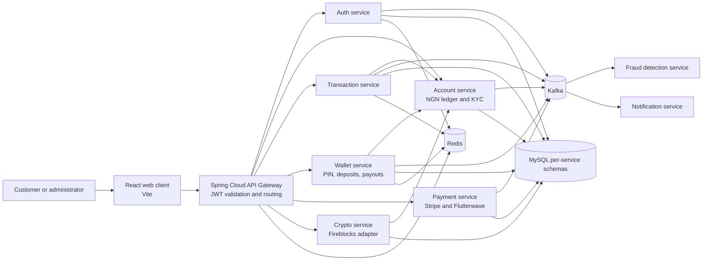

# ELI-PAY Digital Banking System

ELI-PAY is a digital banking application with a React web client and a Java/Spring backend. Customers can manage NGN accounts, make internal and external transfers, add money, withdraw funds, submit identity verification for manual review, and use supported custodial crypto flows. Administrators have a separate operations workspace for customer support, payout and KYC reviews, risk alerts, reconciliation, and audit history.

The backend is split into independently deployable services. Account balances are maintained through an append-only double-entry ledger; idempotency, database transactions, provider verification, and asynchronous events are used to protect money flows from retries and partial failures.

> This repository provides application software and local development infrastructure. It does not by itself provide a licensed banking service, production-ready high availability, a regulated compliance program, or live provider accounts. Review the deployment and security documentation before handling real customer data or funds.

## Contents

- [Application capabilities](#application-capabilities)
- [Architecture](#architecture)
- [Technology stack](#technology-stack)
- [Repository layout](#repository-layout)
- [Requirements](#requirements)
- [Run locally](#run-locally)
- [Configuration](#configuration)
- [Build and verification](#build-and-verification)
- [API and operations](#api-and-operations)
- [Documentation](#documentation)
- [Security and data handling](#security-and-data-handling)
- [Contributing](#contributing)
- [License](#license)

## Application capabilities

### Customer web app

- Sign in, register, manage account settings, and view account balances and activity.
- Open accounts and view transaction history and statements.
- Make internal transfers and transfers to supported external banks, including name enquiry, transfer confirmation, and status tracking.
- Add money through the configured card-payment provider and request withdrawals subject to configured limits and approval rules.
- Set and use a transfer PIN; complete additional verification when a transfer is flagged for review.
- Submit identity documents and a prompted face video for manual KYC review, and submit account-upgrade evidence.
- View notifications and use supported crypto wallet and transaction workflows.

### Administration console

- Review customers, accounts, transactions, and audit events.
- Review submitted KYC evidence and approve or reject verification requests.
- Review and decide eligible payout and crypto operations.
- Monitor risk alerts and ledger reconciliation results.

Administrative access is controlled by backend authorization. Hiding an admin view in the browser is not a security boundary; the API enforces roles independently.

## Architecture



The diagram is a logical view. Each service owns its persistence schema and migrations; services communicate through HTTP for synchronous decisions and Kafka events for asynchronous work. The checked-in local Kafka configuration is a single broker and should not be treated as a highly available production cluster.

| Component | Responsibility |
|---|---|
| `frontend/` | React customer and admin web application; Vite development server and production build. |
| `API-GATEWAY` | Public API entry point, JWT validation, routing, rate limiting, and browser CORS policy. |
| `auth-service` | Registration, login, access and refresh tokens, password flows, roles, and user administration. |
| `account-service` | Account ownership, NGN double-entry ledger, statements, reconciliation, and identity/account-upgrade reviews. |
| `transaction-service` | Internal transfer orchestration and transfer verification. |
| `wallet-service` | PIN workflows, deposits, bank enquiry, withdrawals, payout state, and related idempotency. |
| `payment-service` | Card payment and bank payout provider adapters, payment status, and signed provider webhooks. |
| `fraud-detection-service` | Risk checks used by transaction and payout flows. |
| `notification-service` | Email, OTP, and event-driven customer notifications. |
| `crypto-service` | Crypto wallet and transaction workflows, Fireblocks integration, webhook validation, and admin reviews. |
| `banking-common` | Shared backend types, security helpers, and event contracts. |

Money movement is designed around a single ledger writer, balanced journal entries, transaction locking, unique idempotency keys, and outbox/event processing. Provider callbacks are treated as signals that trigger verification; business state is reconciled against trusted provider data before settlement. See [ARCHITECTURE.md](ARCHITECTURE.md) for detailed flows and limitations.

## Technology stack

| Area | Technology |
|---|---|
| Web | React 18, Redux Toolkit Query, Vite |
| Backend | Java 25, Spring Boot 4, Spring Cloud Gateway |
| Build | Maven wrappers per backend module; npm for the frontend |
| Persistence | MySQL/InnoDB, Flyway migrations, schema ownership per service |
| Events and cache | Apache Kafka and Redis |
| Payments/custody | Stripe, optional Flutterwave payouts, optional Fireblocks custody |
| Local infrastructure | Docker Compose |

## Repository layout

```text
digital-banking-system/
├── README.md
├── ARCHITECTURE.md
├── docs/engineering/          # Security, reliability, operations, and testing guides
├── frontend/                  # React/Vite customer and admin web application
└── bankend/                   # Backend services and local infrastructure (directory name retained)
    ├── API-GATEWAY/
    ├── account-service/
    ├── auth-service/
    ├── crypto-service/
    ├── fraud-detection-service/
    ├── notification-service/
    ├── payment-service/
    ├── transaction-service/
    ├── wallet-service/
    ├── libs/banking-common/
    ├── docs/
    ├── scripts/
    ├── compose.yaml
    └── compose.prod.yaml
```

## Requirements

- Docker Engine and Docker Compose v2 for the backend stack and Testcontainers integration tests.
- Node.js 20 or newer and npm for the web client.
- JDK 25 if building or running backend services outside Docker. Docker builds use multi-stage Dockerfiles.
- `curl` and `jq` for the backend smoke test.

## Run locally

### 1. Configure the backend

```bash
cd bankend
cp .env.example .env
```

Set local secrets and the required bank and payout settings listed in [Configuration](#configuration). Do not use production credentials for local development. The Compose stack uses the payout simulator by default; external provider credentials are only needed for flows that explicitly use those providers.

### 2. Start the backend

From `bankend/`:

```bash
docker compose up -d --build
docker compose ps
```

The gateway is available at `http://localhost:8080`. The development Compose file also publishes service and infrastructure ports for local development. For an infrastructure-only setup, start `mysql`, `redis`, and `kafka`, then run backend modules with their Maven wrappers.

### 3. Start the web client

In another terminal:

```bash
cd frontend
npm ci
```

Create `frontend/.env.local` if you need to override the local API URL or enable Stripe checkout:

```dotenv
VITE_API_URL=http://localhost:8080
VITE_STRIPE_PUBLISHABLE_KEY=pk_test_replace_me
```

Run the development server:

```bash
npm run dev
```

Open the URL printed by Vite (normally `http://localhost:5173`). The gateway's default local CORS origins include this address. Frontend environment variables are bundled into the browser app; never put secret keys in `VITE_*` variables.

To stop the backend stack, run `docker compose down` from `bankend/`. Named database volumes remain in place. Use `docker compose down -v` only when you intentionally want to delete local database data.

## Configuration

Backend configuration is read from `bankend/.env`; the template is [bankend/.env.example](bankend/.env.example). The template documents the main secrets and provider settings but does not currently include every variable required by Compose. Add the following for the full local stack:

| Variable | Purpose |
|---|---|
| `OWN_BANK_CODE`, `OWN_BANK_NAME` | Identifies this bank in bank-list and transfer flows. |
| `WITHDRAWAL_MIN`, `WITHDRAWAL_MAX`, `WITHDRAWAL_DAILY_MAX` | Per-request and daily outbound NGN limits. |
| `WITHDRAWAL_APPROVAL_THRESHOLD` | Amount at which payout approval is required. |
| `PIN_PEPPER`, `PIN_OTP_HMAC_KEY` | Wallet PIN and PIN challenge protection keys; use distinct random values of at least 32 bytes. |

The template also contains database, JWT, internal-service, OTP, admin, SMTP, Stripe, and Fireblocks settings. Optional provider settings include Flutterwave payout credentials. Fireblocks is disabled by default. Use a test/sandbox provider configuration for development and configure matching webhook secrets and public callback URLs when testing provider callbacks.

Generate distinct local signing keys with a password manager or a cryptographically secure generator. Never reuse example values or commit `.env`, private keys, access tokens, or provider credentials. Production secrets must come from a secrets manager.

## Build and verification

Run the frontend production build:

```bash
cd frontend
npm run build
```

Build backend service artifacts locally (tests skipped):

```bash
cd bankend
./scripts/build.sh
```

Run the backend service tests, including Testcontainers integration tests (Docker required):

```bash
cd bankend
./scripts/build.sh --test
```

Run the gateway smoke test against a running local stack:

```bash
cd bankend
./scripts/smoke-test.sh
```

`./scripts/smoke-throwaway.sh` runs the disposable end-to-end money-path checks. Review the script before running it and ensure Docker has enough resources. Do not point tests or smoke scripts at production systems or production credentials.

## API and operations

- Local gateway base URL: `http://localhost:8080`
- Gateway health: `http://localhost:8080/actuator/health`
- OpenAPI/Swagger UI is available in development when enabled by the service configuration; production Compose disables it.
- Backend OpenAPI snapshots: [`bankend/docs/openapi/`](bankend/docs/openapi/)
- API route configuration: [`bankend/API-GATEWAY/src/main/resources/application.yaml`](bankend/API-GATEWAY/src/main/resources/application.yaml)

The primary user API groups include `/api/v1/auth`, `/api/v1/accounts`, `/api/v1/transactions`, `/api/v1/wallet`, `/api/v1/payments`, and the crypto API. Provider callbacks use dedicated webhook routes. Consult the OpenAPI snapshots and service controllers for the exact request and response contracts.

## Documentation

- [Architecture and design decisions](ARCHITECTURE.md)
- [Backend service docs](bankend/docs/)
- [Engineering and operations guides](docs/engineering/)
- [Local/production deployment notes](bankend/docs/deploy.md)
- [Ledger model](bankend/docs/ledger.md)
- [Threat model for PIN flows](bankend/docs/threat-model-pin.md)

The engineering guides describe the current implementation and distinguish it from deployment work that still requires external infrastructure or validation. In particular, the checked-in Compose Kafka setup is a single local broker; production high availability, backup restoration, load targets, and external security controls must be designed and verified for the target environment.

## Security and data handling

The app handles financial and identity data, including submitted identity documents and face-verification videos for manual KYC review. Restrict administrator access, secure the database and backups, define retention and deletion rules, and avoid placing customer documents or secrets in logs. Local Compose is for development and is not a production security boundary.

Before deploying to a real environment, configure TLS and an edge/WAF policy, private service networking, managed secrets, database backup and restore procedures, Kafka authentication and availability, monitoring and alerting, provider webhook delivery, access reviews, and incident response. Validate applicable licensing, privacy, KYC/AML, and data-protection requirements with qualified professionals for each operating jurisdiction.

## Contributing

1. Create a focused branch from the current development baseline.
2. Keep service ownership and API contracts explicit; document schema or event changes.
3. Add or update tests for the affected behavior, especially money movement, idempotency, authorization, and provider callbacks.
4. Run the relevant frontend build or backend tests before opening a pull request.
5. Never commit secrets, customer data, production dumps, or generated build output.

## License

This project is distributed under the [MIT License](LICENSE).
